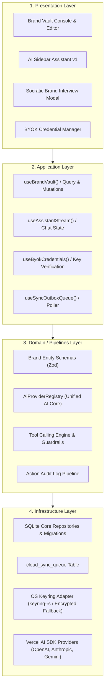

# Solution Spec: shell-brand-vault-sqlite-orchestrator Implementation

## 1. Governance & Agent Assignment
- **Initiative Planner**: `planner`
- **Lead Implementation Specialist**: `architect` & `db` (Sustrato y Esquema SQLite), `frontend` (UI Brand Vault y Sidebar), `api` / `security` (Keychain BYOK y Registry AI)
- **Architect Gatekeeper**: `architect` (Gate 1 & Gate 2)
- **Quality & Review**: `qa` & `reviewer`
- **Security Auditor**: `security` (Auditoría de bypass de llaves, cifrado de credenciales y guardrails de tool calling)

## 2. Solution Overview & 4-Layer Architecture

La solución implementa la base arquitectónica de Indie-Sync Suite dividida estrictamente en 4 capas funcionales:



### 1. Presentation Layer (`apps/web/src/presentation` / `components`)
- `components/brand-vault/`: Formularios de creación y edición de Sello y Artista, selectores de paleta de colores, tipografías y enlaces.
- `components/settings/byok-credentials/`: Gestor de API keys con botones de verificación ("Probar Conexión") e insignias de estado en tiempo real.
- `components/assistant/`: Sidebar lateral desplegable con interfaz conversacional interactiva y renderizado de tool calls.
- `components/assistant/guardrail-modal.tsx`: Diálogo modal de confirmación previa a la ejecución de acciones destructivas o de presupuesto.

### 2. Application/Consumption Layer (`apps/web/src/application`)
- Hooks reactivos de consulta y mutación para entidades de marca (`useLabels`, `useArtists`, `useBrandVault`).
- Hook gestor de conversación agéntica con streaming (`useAiAssistant`).
- Hook gestor de credenciales y estados de cuota (`useCredentialsState`).
- Procesador de la cola outbox (`processOutboxQueue`).

### 3. Domain/Pipelines/Services Layer (`apps/web/src/domain`)
- Esquemas de validación Zod para `LabelProfile`, `ArtistProfile`, `ReleaseHierarchy`, `CredentialRecord`.
- `AiProviderRegistry`: Factoría singleton que resuelve clientes LLM instanciados dinámicamente según las credenciales del usuario.
- `ToolDefinitionRegistry`: Especificación de herramientas con JSON Schema y tipado estricto.
- `GuardrailEvaluator`: Interceptor que analiza los parámetros de una tool antes de su invocación y decide si requiere confirmación humana.
- `ActionLogService`: Registro inmutable y estructurado de eventos ejecutados por agentes.

### 4. Infrastructure Layer (`apps/web/src/infrastructure`)
- Repositorio SQLite (`sqlite-client.ts`, `migrations/`, `repositories/`): Persistencia local relacional de alta velocidad y cero latencia.
- Tabla outbox `cloud_sync_queue` con marcas de estado (`PENDING`, `PROCESSING`, `SYNCED`, `FAILED`).
- Adaptador de llavero seguro (`keyring-adapter.ts`): Comunicación con `keyring-rs` en Tauri o cifrado AES-GCM local en Node con salt de máquina.
- Conectores HTTP para pruebas de salud y cuotas hacia endpoints de OpenAI, Anthropic y Google AI.

---

## 3. Atomic Slices & Logical Sequence

Conforme a la estrategia de ejecución definida en la propuesta conceptual, la Épica 1 se divide en 6 SPECs atómicas agrupadas en dos sub-hitos:

### Sub-Hito 1.A: Sustrato Determinista (Persistencia y Bóveda Segura)

#### SPEC-01: SQLite Core Relational Schema & Outbox Queue (HU-1.6)
- **Rama**: `SPEC/jaymusicmachine-EPIC-01-spec01-sqlite-core-outbox-queue`
- **Alcance**: Migraciones iniciales en SQLite para `labels`, `artists`, `releases`, `release_phases`, `tasks`, `external_audio_links` y `cloud_sync_queue`.
- **Entregables**: Tablas normalizadas, índices de consulta, pruebas de integridad referencial y repositorio CRUD base.

#### SPEC-02: BYOK Secure Keyring & Health Verification Engine (HU-1.3, HU-1.5)
- **Rama**: `SPEC/jaymusicmachine-EPIC-01-spec02-byok-keyring-health-engine`
- **Alcance**: Almacenamiento seguro de credenciales (OS Keychain / fallback cifrado), servicio de comprobación de conectividad y cálculo de balance/cuotas para OpenAI, Anthropic y Gemini.
- **Entregables**: Adaptador `KeyringAdapter`, endpoints locales de validación, estados de salud (activo, cuota baja, error) y consola UI de configuración.

#### SPEC-03: Brand Vault Domain Entities & CRUD UI (HU-1.1)
- **Rama**: `SPEC/jaymusicmachine-EPIC-01-spec03-brand-vault-entities-crud-ui`
- **Alcance**: Interfaz completa y repositorios para la gestión del Brand Vault (Sello y Artistas): paletas hexadecimales, fuentes tipográficas, biografías, muestras de estilo y perfiles de redes.
- **Entregables**: Componentes accesibles, validación Zod estricta, integración con persistencia SQLite y pruebas de flujo completas.

### Sub-Hito 1.B: Activación Agéntica (AI Core y Asistente Operativo)

#### SPEC-04: Unified AiProviderRegistry & Streaming Engine
- **Rama**: `SPEC/jaymusicmachine-EPIC-01-spec04-ai-provider-registry-streaming`
- **Alcance**: Instanciación dinámica y desacoplada de modelos LLM sobre Vercel AI SDK Core (`ai`) alimentada en tiempo de ejecución por las credenciales del BYOK Keyring.
- **Entregables**: Registro `AiProviderRegistry`, soporte multi-proveedor con fallback inteligente y endpoints de streaming seguros.

#### SPEC-05: Tool Calling Contracts, Guardrails & Action Audit Log (HU-6.3)
- **Rama**: `SPEC/jaymusicmachine-EPIC-01-spec05-tool-calling-guardrails-action-log`
- **Alcance**: Catálogo extensible de tools operativas de Brand Vault con validación JSON Schema, interceptor de guardrails para acciones destructivas o de presupuesto con confirmación humana requerida, y tabla SQLite de `action_log`.
- **Entregables**: Especificación de tools, evaluador de riesgos, modal de confirmación en UI y persistencia de auditoría.

#### SPEC-06: Socratic Brand Interview & Lateral Assistant Sidebar v1 (HU-1.2, HU-6.1 v1)
- **Rama**: `SPEC/jaymusicmachine-EPIC-01-spec06-socratic-interview-sidebar-v1`
- **Alcance**: Asistente conversacional lateral desplegable (Sidebar v1) y wizard interactivo de entrevista socrática para sintetizar el manual de identidad del artista directamente en el Brand Vault.
- **Entregables**: Componente Sidebar con streaming y visualización de tool execution, flujo conversacional guiado e inyección automática de datos en SQLite.

---

## 4. TDD (Test-Driven Development) Strategy

Cada SPEC iniciará obligatoriamente en fase RED con tests completos antes de escribir código de producción:

### Unit/Integration Tests (Fase RED)
- **SQLite & Outbox Tests**: `tests/infrastructure/db/sqlite-schema.test.ts` (verifica DDL, cascadas de clave foránea, triggers e inserciones en outbox).
- **Keyring & Security Tests**: `tests/infrastructure/security/keyring-adapter.test.ts` (verifica cifrado, almacenamiento seguro, manejo de errores y pruebas de conectividad de APIs con mocks de transporte).
- **Brand Vault Domain Tests**: `tests/domain/brand-vault/brand-profile-validation.test.ts` (valida restricciones Zod, paletas hex válidas, URLs de streaming y tipografías).
- **Tool Calling & Guardrails Tests**: `tests/domain/agent/tool-guardrails.test.ts` (valida intercepción de mutaciones destructivas, exigencia de confirmación y registro en Action Log).
- **AI Registry Tests**: `tests/domain/agent/ai-provider-registry.test.ts` (comprueba resolución de providers, inyección de API keys desde keychain y tolerancia a fallos).

Comandos de ejecución de pruebas:
```bash
pnpm test
pnpm test:harness
```

---

## 5. Local Definition of Done (DoD)
- [ ] Todas las 6 SPECs completadas siguiendo estrictamente el ciclo RED-GREEN-REFACTOR.
- [ ] La fase actual del tracker de estado es `PHASE_8_HUMAN_MERGE_APPROVED`.
- [ ] Suite completa de pruebas pasa al 100% en verde.
- [ ] `pnpm validate` se ejecuta con 0 errores y 0 warnings (lint, typecheck, arquitectura, docs governance y harness).
- [ ] Cero deuda técnica o código huérfano; comentario in-code obligatorio con roles de capa y bloques JSDoc/TSDoc.
- [ ] Aprobación explícita del humano registrada antes de merge a `develop`.

---

## 6. Spec Artifact Traceability
- **Parent Epic Branch**: `epic/jaymusicmachine-EPIC-01-shell-brand-vault-sqlite-orchestrator`
- **Problem Spec**: [feature-jaymusicmachine-EPIC-01-shell-brand-vault-sqlite-orchestrator.md](file:///Users/jaymusicmachine/Documents/Desarrollo/indie-sync-suite/knowledge/features/feature-jaymusicmachine-EPIC-01-shell-brand-vault-sqlite-orchestrator.md)
- **Solution Spec**: [feature-jaymusicmachine-EPIC-01-shell-brand-vault-sqlite-orchestrator-implementation.md](file:///Users/jaymusicmachine/Documents/Desarrollo/indie-sync-suite/knowledge/features/feature-jaymusicmachine-EPIC-01-shell-brand-vault-sqlite-orchestrator-implementation.md)
- **Epic RFC**: [knowledge/rfcs/EPIC-001-shell-brand-vault-sqlite-orchestrator/README.md](file:///Users/jaymusicmachine/Documents/Desarrollo/indie-sync-suite/knowledge/rfcs/EPIC-001-shell-brand-vault-sqlite-orchestrator/README.md)
- **First Story RFC**: [knowledge/rfcs/EPIC-001-shell-brand-vault-sqlite-orchestrator/STORY-001-01-kickoff.md](file:///Users/jaymusicmachine/Documents/Desarrollo/indie-sync-suite/knowledge/rfcs/EPIC-001-shell-brand-vault-sqlite-orchestrator/STORY-001-01-kickoff.md)
